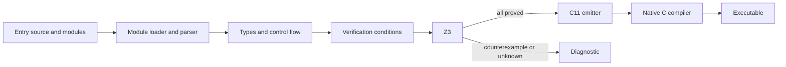

# How the compiler works

Clack's implementation is intentionally small enough to read from source. It is a native compiler with an SMT verification step. It is not a Python interpreter for Clack programs, and the generated executable does not contain the compiler or solver.

## The pipeline

The public command-line path follows this order for every emission or execution. `check` stops after verification. `emit-c` stops after C emission. `build` keeps the native executable, while `run` builds and executes one in a temporary directory.

| Source module | Responsibility |
| --- | --- |
| [frontend.py](../clack/frontend.py) | Source locations, AST, lexer adapter, recursive-descent parser |
| [modules.py](../clack/modules.py) | Local and bundled imports, name resolution, merged program and source maps |
| [typecheck.py](../clack/typecheck.py) | Types, definite assignment, parameter immutability, effects, call graph |
| [verifier.py](../clack/verifier.py) | Symbolic execution and solver obligations |
| [codegen.py](../clack/codegen.py) | Verified AST to C11, including thread wrappers |
| [cli.py](../clack/cli.py) | Options, diagnostics, compiler invocation, executable handling |

## Parsing and static checks

`frontend.parse(source)` returns a `Program` containing functions, records, and import declarations, or raises `CompileError` with a source line and column. Python's tokenizer supplies lexical tokens and indentation markers. Clack's own parser decides the grammar and builds Clack AST nodes. Source is never evaluated by Python.

The CLI uses `modules.load_program(path)` to load the entry file and resolve its imports. Local module paths are relative to the importing source file. Bundled `std` modules are package resources and cannot be replaced by a local `std` directory. Imports explicitly select functions and records; library files do not define main.

The loader constructs a merged program with distinct internal names for declarations and their references. `Program.locations` records mappings back to original source files and lines for diagnostics. These are compiler bookkeeping, not module objects or Python execution exposed to the source language. All declarations of loaded libraries participate in checking, not just the ones eventually called.

The type checker collects the loaded declarations before checking bodies, so definition order does not dictate call order. It validates record layouts, types, function signatures, builtins, and supported expressions. It tracks which locals exist on every continuing path. Parameters cannot be assigned or mutated. The only output operation is `print`, allowed in main; main cannot be called as a worker.

It also builds the runtime call graph and rejects cycles. The resulting callee-first order makes modular verification possible: a helper is checked before its postconditions are used to describe its result at a call site. `TypeInfo` holds local types, expression types, function and record maps, and that order.

The [standard library](libraries.md) uses the same mechanism. Its math and fixed-array helpers are Clack source, not additional compiler builtins or assumed axioms. Their preconditions and bodies are checked as part of the loaded program.

## Symbolic execution

`verifier.verify(program, timeout_ms=5000, proof_dir=None)` invokes static checking and returns a `Verification` only after all obligations pass. A symbolic state contains an environment of typed terms and a path condition.

Assignments change the local binding's symbolic value. Branches create states guarded by the condition or its negation. Returns must establish every postcondition under the facts of that path. At a call, the caller establishes the helper's preconditions, then receives a fresh result constrained by the helper's already-checked postconditions and type bounds.

For a required claim `P`, the verifier asks whether `path and not P` is satisfiable. `unsat` establishes that no counterexample exists under those facts. `sat` produces a model used in the diagnostic. `unknown`, including timeout, is rejected. No state is accepted merely because the programmer wrote a contract or assertion.

## Arithmetic and composite values

The verification model uses mathematical integer terms. Executable arithmetic additionally generates signed 64-bit range obligations for each intermediate. Proof annotations omit executable range checks so they can describe larger mathematical values. Division remains defined only for nonzero divisors; executable signed division and remainder must also exclude the minimum integer divided by negative one.

Z3's integer division and C's signed division differ for negative operands. The verifier explicitly builds a quotient from absolute magnitudes and the operand signs to model truncation toward zero. Remainder is `a - quotient * b`.

Records use solver datatypes. Fixed arrays use solver arrays, with their lengths recorded in the Clack type. Reads and writes generate bounds obligations. Fresh composite symbols receive appropriate bounds for their integer contents, including nested record fields. These logical representations do not prescribe the native ABI.

## Why loops forget values

Checking only the first iteration would miss failures later in a loop. Instead, the verifier proves the invariant at entry, replaces every body-modified binding with a fresh symbolic value, and assumes the invariant at that arbitrary loop head. This replacement is commonly called *havoc*. An element write marks its whole array as modified for this purpose.

Under the true condition, the body must preserve the invariant and strictly decrease a measure that is nonnegative at iteration start. Under the false condition, the invariant describes the state after the loop. A return inside the body establishes postconditions directly. This is the core reason a useful invariant matters: facts about modified values do not survive just because they held before the loop.

Short-circuit expressions require similar care. The right operand is checked only under its evaluation guard. Any facts from a helper call on that side must also remain guarded; a skipped call cannot make the caller's path impossible.

## C representation and threads

`codegen.emit_c(program, local_types, expr_types)` assumes successful verification. It is an internal emitter, not an independent checking boundary. The CLI always calls it after `verify`.

Integers become `int64_t`, Booleans become `bool`, and records and fixed arrays become structs passed by value. Identifiers are prefixed to avoid C keyword collisions. The signed minimum literal has a special representation that does not first create an out-of-range positive signed literal. Proof annotations and successful assertions are removed.

For each parallel job, the emitter creates a typed task struct and a POSIX thread trampoline. It snapshots all arguments, attempts to launch each job, joins successfully launched threads, and then assigns results to the Clack bindings. A failed launch executes its worker synchronously. If joining a launched thread fails, the generated program aborts rather than reading a result that may still be written.

The CLI invokes the selected C compiler with C11, optimization, warnings, and `-pthread`. A build uses temporary files beside its destination and replaces an existing binary only after successful compilation.

## What remains trusted

The parser, type checker, condition generator, Z3, C emitter, C compiler, runtime support, operating system, and hardware are trusted components. The compiler has regression tests, including native execution and actual thread launches; it has not been proved correct end to end.

SMT export makes obligations inspectable and reproducible. It does not independently certify that the emitted machine code implements the source. Resource exhaustion and scheduling behavior are also outside the mathematical execution model. Keep these distinctions when changing the implementation or making assurance claims.

[Verification model](verification.md) · [Contributing](contributing.md) · [Handbook](README.md)
