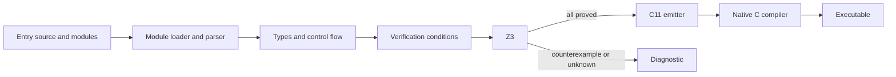

# How the compiler works

Clack's implementation is intentionally small enough to read from source. It is a native compiler with an SMT verification step. It is not a Python interpreter for Clack programs, and the generated executable does not contain the compiler or solver.

## The pipeline

The public command-line path follows this order for every emission or execution. `check` stops after verification. `emit-c` stops after C emission. `build` keeps the native executable, while `run` builds and executes one in a temporary directory.

| Source module | Responsibility |
| --- | --- |
| [frontend.py](../clack/frontend.py) | Source locations, AST, lexer adapter, recursive-descent parser |
| [modules.py](../clack/modules.py) | Local and bundled imports, name resolution, merged program and source maps |
| [typecheck.py](../clack/typecheck.py) | Types, definite assignment, parameter immutability, effects, call graph |
| [arrayops.py](../clack/arrayops.py) | Shared typed registry for imported array constructors and reductions |
| [verifier.py](../clack/verifier.py) | Symbolic execution and solver obligations |
| [codegen.py](../clack/codegen.py) | Verified AST to C11, including thread wrappers |
| [cli.py](../clack/cli.py) | Options, diagnostics, compiler invocation, executable handling |

## Parsing and static checks

`frontend.parse(source)` returns a `Program` containing functions, records, and import declarations, or raises `CompileError` with a source line and column. Python's tokenizer supplies lexical tokens and indentation markers. Clack's own parser decides the grammar and builds Clack AST nodes. Source is never evaluated by Python.

The CLI uses `modules.load_program(path)` to load the entry file and resolve its imports. Local module paths are relative to the importing source file. Bundled `std` modules are package resources and cannot be replaced by a local `std` directory. Imports explicitly select functions and records; library files do not define main. `native` declarations resolve confined module-relative C files into `Program.native_sources`, while `Function.foreign_symbol` distinguishes an explicit external declaration from a source function.

The loader constructs a merged program with distinct internal names for declarations and their references. `Program.locations` records mappings back to original source files and lines for diagnostics. These are compiler bookkeeping, not module objects or Python execution exposed to the source language. All declarations of loaded libraries participate in checking, not just the ones eventually called.

The type checker collects the loaded declarations before checking bodies, so definition order does not dictate call order. It validates record layouts, types, function signatures, builtins, and supported expressions. It tracks which locals exist on every continuing path. Parameters cannot be assigned or mutated. `print` is allowed only in main, as are direct external unit statements and external result assignments; main cannot be called as a worker. Native calls are rejected inside nested expressions and ordinary helpers, keeping the verified worker graph free of foreign effects.

It also builds the runtime call graph and rejects cycles. The resulting callee-first order makes modular verification possible: a helper is checked before its postconditions are used to describe its result at a call site. `TypeInfo` holds local types, expression types, function and record maps, and that order.

The [standard library](libraries.md) uses the same mechanism for its math and fixed-size source helpers. Their preconditions and bodies are checked as part of the loaded program. The `std.array` compiler operators are different: the loader exposes reserved internal operators through explicit public imports, and the shared registry records their input and result types. They have direct verifier and C-backend implementations rather than source bodies. A local module cannot replace the bundled namespace or call the internal spellings directly.

## Symbolic execution

`verifier.verify(program, timeout_ms=5000, proof_dir=None)` invokes static checking and returns a `Verification` only after all obligations pass. A symbolic state contains an environment of typed terms and a path condition.

Assignments change the local binding's symbolic value. Branches create states guarded by the condition or its negation. Continuing branches are joined using conditional values and the disjunction of their path conditions; returned paths have already established their postconditions. This avoids enumerating every branch combination in later statements. At a source function call, the caller establishes the helper's preconditions, then receives a fresh result constrained by its already-checked postconditions and type bounds.

For a required claim `P`, a claim that simplifies unconditionally to `true` needs no solver query. Otherwise the verifier asks whether `path and not P` is satisfiable. One solver belongs to that verification run; each obligation uses a fresh push/pop scope, so assertions cannot leak between obligations, branches, or functions. Reusing the solver avoids recreating it for every nontrivial claim. `unsat` establishes that no counterexample exists under those facts. `sat` produces a model used in the diagnostic. `unknown`, including timeout, is rejected. A constant `false` still needs its path checked, because it can be legitimate on an unreachable path. No state is accepted merely because the programmer wrote a contract or assertion. Proof export still records replayable queries for all obligations, including simplified ones.

`fill` evaluates its value once and uses a constant solver array, with the checked literal length recorded in the Clack type. Reductions read their argument once and model each fixed-array element. `sum` constructs the mathematical left-to-right sum and a combined obligation covering every nontrivial prefix's signed bounds. `minimum` and `maximum` select elements with conditional comparisons, without overflow-prone arithmetic. `all` and `any` use exact conjunction and disjunction. `count` sums `if element then 1 else 0`; its maximum is the checked array length, at most one million. Reduction expansion grows with array length and is not a constant-time verification algorithm, even when the array came from `fill`.

The verifier does not inspect native C bodies. A native scalar return becomes a fresh unconstrained term bounded only by its declared type; no foreign contract can add assumed properties. Text is carried as an opaque typed value, with all current runtime text originating in static literals. The CLI reports the native boundary explicitly rather than counting external implementations as proved Clack functions.

## Arithmetic and composite values

The verification model uses mathematical integer terms. Executable arithmetic additionally generates signed 64-bit range obligations for each intermediate. Numeral bounds are evaluated directly into Boolean claims rather than constructing comparison terms; the obligation is still recorded, and a false claim must still be checked against its path. Proof annotations omit executable range checks so they can describe larger mathematical values. Division remains defined only for nonzero divisors; executable signed division and remainder must also exclude the minimum integer divided by negative one.

Z3's integer division and C's signed division differ for negative operands. The verifier explicitly builds a quotient from absolute magnitudes and the operand signs to model truncation toward zero. Remainder is `a - quotient * b`.

Records use solver datatypes. Fixed arrays use solver arrays, with their lengths recorded in the Clack type. Reads and writes generate bounds obligations. Fresh composite symbols receive appropriate bounds for their integer contents, including nested record fields. These logical representations do not prescribe the native ABI.

## Why loops forget values

Checking only the first iteration would miss failures later in a loop. Instead, the verifier proves the invariant at entry, replaces every body-modified binding with a fresh symbolic value, and assumes the invariant at that arbitrary loop head. This replacement is commonly called *havoc*. An element write marks its whole array as modified for this purpose.

Under the true condition, the body must preserve the invariant and strictly decrease a measure that is nonnegative at iteration start. Under the false condition, the invariant describes the state after the loop. A return inside the body establishes postconditions directly. This is the core reason a useful invariant matters: facts about modified values do not survive just because they held before the loop.

A counted `For` evaluates start and stop once, then lowers to the same while-loop verifier with private bound snapshots, automatic index facts, a mathematical `stop - index` measure, and a generated increment. User invariants are checked after that increment. The type checker makes the source index immutable and scoped to the body. The C emitter uses a native counted loop with the same bound snapshots; the strict upper comparison ensures incrementing cannot overflow, even when a bound is the maximum signed integer.

Short-circuit expressions require similar care. The right operand is checked only under its evaluation guard. Any facts from a helper call on that side must also remain guarded; a skipped call cannot make the caller's path impossible.

## C representation and threads

`codegen.emit_c(program, local_types, expr_types)` assumes successful verification. It is an internal emitter, not an independent checking boundary. The CLI always calls it after `verify`.

After all loaded source functions have passed verification, the emitter follows calls from `main` and emits only reachable function declarations and bodies, parallel trampolines, and array-operation helpers. An unused function is still checked and can reject compilation; it simply does not enlarge the generated C. Type definitions remain available for all recorded types, and the CLI still compiles every declared native C provider.

Integers become `int64_t`, Booleans become `bool`, text becomes a `const char *` to immutable NUL-terminated UTF-8, and records and fixed arrays become structs passed by value. Text parsing rejects embedded NUL and invalid Unicode encodings. Identifiers are prefixed to avoid C keyword collisions. The signed minimum literal has a special representation that does not first create an out-of-range positive signed literal. Proof annotations and successful assertions are removed.

For each used array operator and length, the backend emits a specialized C loop. `fill` takes one scalar and returns a struct with every array element initialized to that value. A reduction takes a read-only pointer to the already-evaluated array value, using a temporary for value-returning expressions when necessary. It cannot modify the array, and its input expression is evaluated once. This internal lowering preserves source value semantics and avoids copying a large array solely to reduce it.

For each parallel job, the emitter creates a typed task struct and a POSIX thread trampoline. It snapshots all arguments, attempts to launch the first N−1 jobs, runs the last job on the caller, joins successfully launched threads, and then assigns results to the Clack bindings. A one-job block calls its worker directly. A failed launch executes that worker synchronously. If joining a launched thread fails, the generated program aborts rather than reading a result that may still be written.

The CLI invokes the selected C compiler with C11, optimization, warnings, `-pthread`, and any resolved native C providers. An external declaration emits a C prototype and call, not a verified source body. Builds and emitted C use temporary files beside their destinations and replace existing output atomically after success. Before verification, the CLI checks proof artifact destinations against all loaded inputs. `--timings` reports attempted load, verification, emission, and native compilation phases on standard error. Manual compilation of emitted C must link the same providers; see the [native guide](native.md).

## What remains trusted

The parser, type checker, condition generator, Z3, C emitter, C compiler, runtime support, operating system, and hardware are trusted components. The compiler has regression tests, including native execution and actual thread launches; it has not been proved correct end to end.

SMT export makes obligations inspectable and reproducible. It does not independently certify that the emitted machine code implements the source. Resource exhaustion and scheduling behavior are also outside the mathematical execution model. Keep these distinctions when changing the implementation or making assurance claims.

[Verification model](verification.md) · [Contributing](contributing.md) · [Handbook](README.md)
